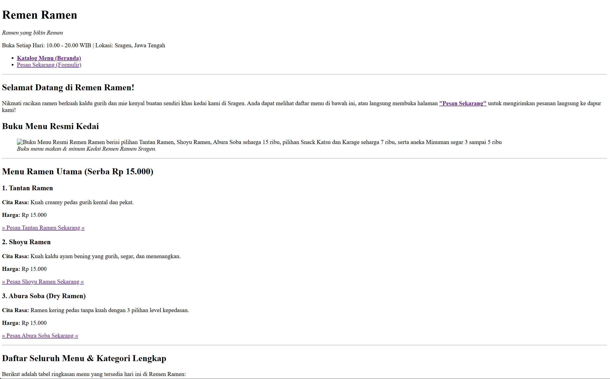
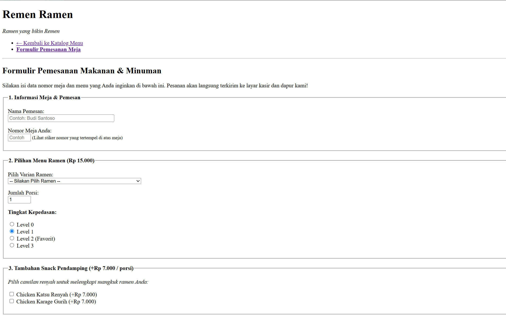
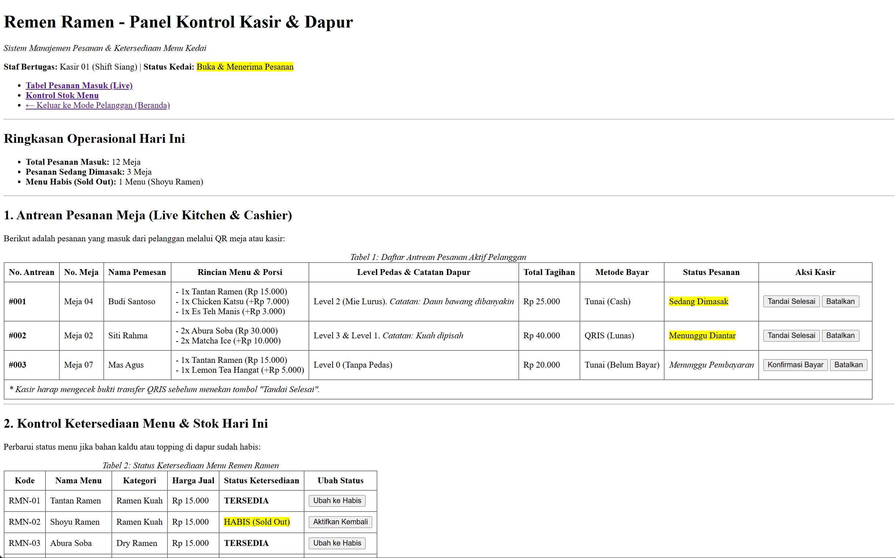

# Remen Ramen — Sistem Katalog & Pemesanan Kedai Ramen 

> *"Ramen yang bikin Remen"*  
> **Tugas Pengembangan Aplikasi Web — Week 2**  
> Tel-U

---

## Identitas Pengembang
* Nama: Yosua
* NIM: 103022400036
* Kelas: SE-48-04
* Dosen Pengampu: Villy Satria Praditha

---

## Latar Belakang & Studi Kasus
**Remen Ramen** adalah sebuah kedai kuliner ramen otentik yang beroperasi di Kabupaten Sragen, Jawa Tengah. Aplikasi web ini dibangun sebagai **cicilan tugas fullstack (Pekan 2 s.d. Pekan 14)** untuk menjawab kebutuhan operasional nyata kedai.

### Konsep Sistem: *Hybrid Table Ordering & Cashier Hub*
Sistem ini dirancang dengan pendekatan *hybrid* (terinspirasi dari model operasional Mie Gacoan) yang memadukan:
1. **Sisi Pelanggan :** Pelanggan dapat melihat katalog menu dan melakukan pemesanan langsung dari meja makan mereka (melalui scan QR Code di meja) tanpa harus antre menumpuk di depan meja kasir.
2. **Sisi Staf :** Tablet Android milik kedai yang diletakkan di meja kasir/dapur difungsikan sebagai panel pantau antrean pesanan yang masuk secara *real-time* serta mengontrol status ketersediaan bahan/menu.

---

## Struktur Halaman Aplikasi

Aplikasi ini dibangun menggunakan murni **HTML5 Semantic** tanpa dependensi CSS eksternal:

### 1. `index.html` (Katalog Menu & Daftar Harga)
* **Peran:** Layar utama bagi pelanggan untuk mengeksplorasi makanan, snack, dan minuman.
* **Elemen Kunci:** 
  * `<header>` dan `<nav>` untuk identitas dan navigasi bersih.
  * `<article>` mandiri untuk sorotan menu utama (*Tantan Ramen*, *Shoyu Ramen*, *Abura Soba*).
  * `<figure>` dan `` yang dilengkapi atribut `alt` deskriptif untuk buku menu kedai.
  * `<table>` data tabular lengkap (10 menu resmi) dengan `<thead>`, `<tbody>`, `<tfoot>`, dan `<caption>`.
  * `<footer>` yang memuat kontak, lokasi Sragen, akun IG `@remenramenn`, serta akses tersembunyi menuju panel kasir.

### 2. `pesan.html` (Formulir Pemesanan Meja)
* **Peran:** Layar transaksi tempat pelanggan (atau kasir) menginput data pesanan meja.
* **Elemen Kunci & Aksesibilitas:**
  * Pengelompokan logis formulir menggunakan `<fieldset>` dan `<legend>`.
  * Seluruh elemen form memiliki pasangan `<label for="...">` yang terhubung presisi ke `id` inputnya.
  * Ragam elemen form: `input text` (Nama), `input number` (No. Meja & Porsi), `select dropdown` (Varian Ramen & Minuman), `input radio` (Level Pedas 0–3 dan Suhu Minum Hot/Ice), `input checkbox` (Snack Katsu & Karage), serta `textarea` (Catatan khusus koki dapur).

### 3. `admin.html` (Dashboard Kasir & Dapur)
* **Peran:** Layar kerja staf kedai pada tablet kasir/dapur.
* **Elemen Kunci:**
  * Ringkasan metrik cepat operasional kedai hari ini.
  * `<table>` Antrean Pesanan Aktif (*Live Kitchen Orders*) yang menampilkan nomor antrean, rincian pesanan, total bayar, metode pembayaran (Tunai/QRIS), dan status pengerjaan.
  * `<table>` Kontrol Ketersediaan Stok (*Sold Out / Tersedia*).
  * Formulir buku catatan pergantian shift kasir.

---

## Penerapan Standar Aksesibilitas (a11y) & Semantic HTML5
* **Semantic HTML5:** Tidak menggunakan *div soup* (`<div>` bertumpuk tanpa makna). Seluruh tata letak menggunakan tag semantik bermakna: `<header>`, `<nav>`, `<main>`, `<section>`, `<article>`, `<figure>`, `<figcaption>`, dan `<footer>`.
* **Aksesibilitas Gambar (`alt`):** Atribut `alt` pada media tidak hanya menuliskan nama file, melainkan menjelaskan isi visual menu secara rinci demi mendukung pembaca layar (*screen reader*).
* **Aksesibilitas Formulir:** Menggunakan atribut standar HTML5 (`required`, `placeholder`, `min`, `max`) serta relasi `<label>` eksplisit pada setiap kontrol input.

---

## Tangkapan Layar Tampilan (Screenshots)

Berikut adalah dokumentasi tampilan struktur HTML murni dari ketiga halaman:

### 1. Halaman Utama / Katalog Menu (`index.html`)


### 2. Halaman Formulir Pemesanan (`pesan.html`)


### 3. Halaman Dashboard Kasir & Dapur (`admin.html`)


---

---

## Update Pekan 3: Styling Desain Visual dengan CSS (`assets/css/style.css`)
* **Identitas Visual & CSS Variables:** Menggunakan palet warna khas kedai Jepang (`--merah`, `--merah-tua`, `--krem`, `--pasir`, `--cokelat`, `--oranye`) serta pola gelombang *Seigaiha* pada `header` dan `footer`.
* **Tipografi:** Mengintegrasikan Google Fonts (`Lilita One` untuk judul & `Quicksand` untuk teks isi).
* **Layout & Responsivitas:** Menerapkan **CSS Grid** dan **Flexbox** pada kartu menu unggulan serta navigasi, dilengkapi `@media` query untuk tampilan *mobile* (maksimal lebar `600px`).
* **Dokumentasi Tangkapan Layar (CSS):**
  * **Tampilan Desktop:**
    ![Tampilan Desktop] 


  * **Tampilan Mobile:**
    ![Tampilan Mobile] 


---

## Struktur Direktori Proyek
```text
RemenRamen/
│
├── index.html              # Halaman 1: Katalog Menu & Rekap Tabular
├── pesan.html              # Halaman 2: Formulir Pemesanan Meja
├── admin.html              # Halaman 3: Dashboard Kasir & Dapur
│
├── assets/
│   ├── css/
│   │   └── style.css                 # Stylesheet CSS 
│   │
│   └── images/
│       ├── menu-flyer.png  # Foto buku menu kedai
│       └── screenshots/    # Folder bukti tangkapan layar tugas
│           ├── screenshot-index-0.png
│           ├── screenshot-pesan-0.png
│           └── screenshot-admin.png
│
└── README.md               # Dokumentasi resmi proyek
```

---

## Roadmap Pengembangan Semester (Pekan 3 s.d. 14)
* [x] **Pekan 2:** Fondasi Struktur Semantic HTML5 & Aksesibilitas (Selesai)
* [x] **Pekan 3:** Styling Desain Visual dengan CSS Murni (Warna brand, tipografi, & layout)
* [ ] **Pekan 4:** Implementasi Framework CSS (Bootstrap / Tailwind) agar responsif di HP & Tablet
* [ ] **Pekan 5–8:** JavaScript Interaktif (Kalkulasi total harga otomatis & keranjang belanja floating)
* [ ] **Pekan 9–14:** Backend & Database PostgreSQL untuk sistem pemesanan nyata
